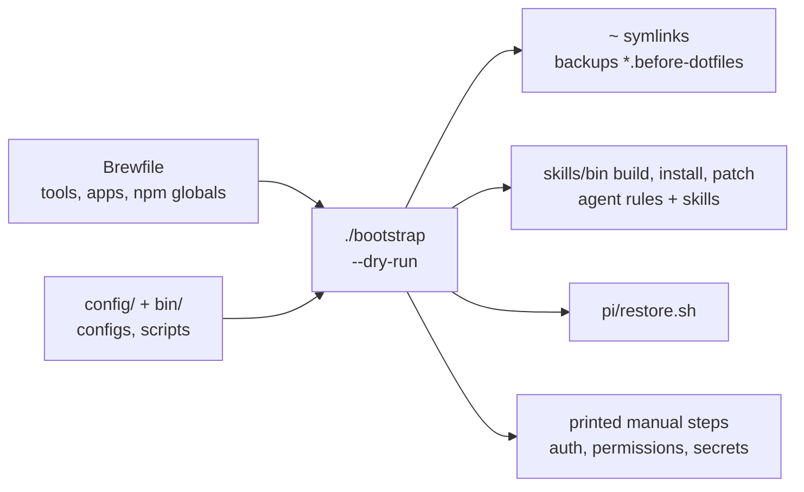

# Dotfiles: agent-desktop, and a bootstrap that rebuilds this machine

## Goal

- **Problem.** agent-desktop is installed, but no rule tells an agent when to use it, and the computer-use MCP skill covers the same job. The repo also can't rebuild this machine. There's no package list and no setup script, the README describes a `claude/rules/` layout that was replaced months ago, and gitconfig, ghostty, zed and two personal scripts exist only in `~`.
- **Result.** agent-desktop is the desktop-app path in `ui-verification`, and computer use is removed. One `./bootstrap` installs every tool on PATH and links every config that holds no secret.
- **Proof.** `./bootstrap --dry-run` on this machine reports nothing to install and nothing to link. The same dry run with `HOME` set to an empty directory lists every link. A real `agent-desktop` snapshot, click, snapshot loop runs against Finder.

## Overview



## 1. agent-desktop in, computer use out

`skills/rules/shared/ui-verification.md`, decision list. Electron and CDP stay with Argent.

```diff
 2. **Agent Browser** (CLI `agent-browser`). ...
-3. Both could work, for example a local Next or Vite app on desktop. ...
+3. **Agent Desktop** (CLI `agent-desktop`). The thing under test is a native desktop app with no
+   CDP endpoint and no device: Finder, System Settings, a menu bar app, a native dialog or sheet.
+   Run `agent-desktop skills get desktop` and `agent-desktop skills get platform` before the first
+   command. It is headless by default. Add `--headed` only when I allow physical input.
+4. Both could work, for example a local Next or Vite app on desktop. ...
```

Skill install: `npx skills add vercel-labs/agent-desktop --skill agent-desktop -g -y`, the same route agent-browser took. Only the core skill. The binary serves the macOS guide at its own version. I diff what lands against what was asked, because of the `-s` trap in `skills/README.md`.

Computer-use removal:

| Where | Change |
| --- | --- |
| `skills/vendored/dmmulroy/patches.toml` | the `append` entry for `use-computer-mcp` becomes a `delete` op, the mechanism impeccable uses, so a dmmulroy reinstall can't bring it back |
| `skills/vendored/dmmulroy/appends/use-computer-mcp.md` | deleted |
| `skills/manifest.toml` | drop `use-computer-mcp` and `[computer_use_mcp]`. Add `[vercel_labs_agent_browser]` (installed today, missing from the manifest) and `[vercel_labs_agent_desktop]` |
| `skills/docs/how-it-works.md:397,407` | drop the two mentions |
| installed copies | `bin/patch` removes them from `~/.agents`, `~/.claude`, `~/.codex`, `~/.grok` |
| MCP server `computer` | `claude mcp remove --scope user computer`, and remove `[mcp_servers.computer]` from `~/.grok/config.toml`. Codex's bundled plugin ships inside the ChatGPT app, so I leave that one alone |

## 2. Packages

`Brewfile`, from `brew bundle dump`, then edited:

- **Kept.** 51 formulae, 12 casks, `gopls` and `staticcheck` (go), and 8 npm globals: pi, monid, codex, argent, agent-desktop, opensrc, portless, yoinks.
- **Added.** `terraform`, `vault`, `graphite` and `peon-ping` are installed from taps and on PATH, but the dump left them out.
- **Dropped.** `cask "minecraft"`. `npm "sort-my-living-v1"`, which is a local `npm link`. `npm "corepack"`, which ships with node. The `cargo "viu"` duplicate of `brew "viu"`. The `theboredteam/boring-notch` tap, which has nothing installed from it.

`brew bundle` has no bun or pnpm type, so bootstrap installs these two lists itself. Bun gets `auditkit`, `effect-solutions`, `@railway/cli` and `create-next-app`. Pnpm gets `vercel`.

These tools come from curl installers. Each one is guarded by `command -v`:

- **Install command known.** rustup, bun, deno, uv, claude, opencode, sst, plannotator, oh-my-zsh, zsh-autosuggestions, zsh-syntax-highlighting, jovial.
- **Install command still to find.** grok, ami, nub, herdr, ax, wtfport, sentry, cursor-agent, terminal-browser, cli-proxy-api. If I can't find an official command for one, it goes in the README's manual list with its homepage. I won't guess a URL.

Apps installed by hand that put a CLI on PATH: OrbStack, Zed, Cursor, ChatGPT, Ollama, Raycast, VS Code, Cap, Cardboard, Kiro, Trae, Antigravity, Docker Desktop. They go in a README list, not in the Brewfile. As casks, `brew bundle` on this machine would try to install over the copies already there.

## 3. Configs and scripts

| Repo | Live | Today |
| --- | --- | --- |
| `zshrc` | `~/.zshrc` | already linked |
| `zprofile` | `~/.zprofile` | new |
| `config/git/config` | `~/.gitconfig` | new |
| `config/git/ignore` | `~/.config/git/ignore` | new |
| `config/ghostty/config` | `~/.config/ghostty/config` | new |
| `config/television/config.toml` | `~/.config/television/config.toml` | new |
| `config/zed/settings.json`, `keymap.json` | `~/.config/zed/` | new |
| `bin/claude-acct`, `bin/wa` | `~/.local/bin/` | moved. `~/.local/bin` holds the only copy today. Same pattern as `bin/usage` |

I scanned each one for tokens and found none. Before linking, bootstrap copies any live file that differs to `<name>.before-dotfiles`. That's the convention `pi/restore.sh` already uses.

These stay out because they hold live secrets. The README says what goes in each:

- `~/.zshenv` has `CPA_KEY`.
- `~/.npmrc` has an npm token.
- `~/.claude/settings.json` has the proxy token in `env`.
- `~/.codex/config.toml` has the Context7 key and bearer tokens.
- `~/.cli-proxy-api/` and `~/.config/wa/` hold private config for those two tools.

## 4. zshrc cleanup

The uncommitted `pi()` wrapper stays exactly as it is.

- The 33 identical `# Added by Antigravity` PATH lines become 1. I keep the one after `ami`, so the de-duplicated PATH order doesn't change.
- The second `bun` block and the repeated `gplr` and `grep` aliases go.
- `/Users/blank/...` becomes `$HOME/...`.
- The Pi line moves from `fnm/node-versions/v24.19.0/installation/bin` to `fnm/aliases/default/bin`. Today both are the same directory, because `default` points at v24.19.0. On a new machine the alias follows whatever version is set as default.
- `. "$HOME/.deno/env"` gets a `[ -s ]` guard, so a machine without deno doesn't print an error on every shell start.

Proof: `zsh -ic` dumps of the de-duplicated PATH and of `alias` match before and after.

Left alone: `gc` means `git commit` in zprofile and `git commit -am` in zshrc. zshrc loads later and wins today, so behavior doesn't change.

## 5. Bootstrap

`./bootstrap [--dry-run]`, in bash. It runs these steps in order, and each one skips anything already present:

1. Install Homebrew.
2. Install fnm and node 24. `brew bundle` installs the npm entries with whatever npm is on PATH, so node has to exist first.
3. `brew bundle`, then the bun and pnpm globals.
4. oh-my-zsh and its plugins, then the curl installers.
5. Links.
6. `skills/bin/build`, `install` and `patch`, plus the agent-browser and agent-desktop skills.
7. `pi/restore.sh`.
8. Print the manual steps: `gh auth login`, `pi auth`, `agent-desktop permissions --guide`, `agent-browser install`, `argent init -y`, and the secret files from section 3.

## 6. README and stale files

- `README.md` gets rewritten. It covers what the repo sets up, the one command, what's kept out and why, the manual steps, and the layout.
- `claude/rules/` is removed. It holds 5 symlinks, `agentation.md` and `anydoc.md` point at files that no longer exist, and `skills/bin/install` is the real install path. The empty `claude/hooks/` goes too. `claude/sync-rules.sh` stays.
- The `skills/manifest.toml` header points at `bin/manifest` and `bin/install --skills`, and neither exists. It will point at the `npx skills add` route instead.

## Not in this change

- **Restoring all ~260 vendored skills on a new machine.** `skills add -s` installs extras, so this needs its own install-and-diff script. Bootstrap installs the two agent-* skills and prints where the manifest is.
- **Templates for `~/.claude/settings.json` and `~/.codex/config.toml` with secrets stripped.** Possible, but not needed for this change.
- **A fresh-machine run.** I have no clean VM. The dry runs prove detection and linking only, so the end-to-end install stays unverified.

No commits unless you ask. Your uncommitted `bin/usage` change isn't touched.

## Decisions

1. Remove the `computer` MCP server from Claude and Grok as well as the skill? I'd say yes. Its tools would still be offered beside agent-desktop.
2. Hand-installed apps go in a README list, not as Brewfile casks? I'd say the README list.
3. Drop the minecraft cask? I'd say yes.
